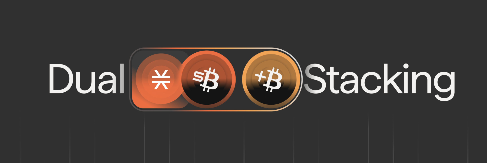

# Dual Stacking

<figure><figcaption></figcaption></figure>


**Dual Stacking has ended.** The program concluded at Bitcoin block 966,350 on September 10, 2026, the block at which Bitcoin Staking opened its Genesis bond. Rewards accrued through that block and were paid in a final distribution afterward. This page is kept as a record. For BTC yield today, see [Bitcoin Staking](bitcoin-staking/).


## What Dual Stacking was

Dual Stacking was a reward program for sBTC holders. Participants enrolled their sBTC and received rewards in sBTC every reward cycle. The rewards came from an incentive budget: at launch, Stacks entities contributed the stacking rewards they earned through Proof of Transfer. The program ran as smart contracts and left PoX consensus and native stacking rewards unchanged.

Participants enrolled through the web app at app.stacks.co, with Leather, Xverse, Fordefi or Asigna. The minimum enrollment was 10,000 sats of sBTC. STX already stacked through any pool counted toward a participant's boost, and the app detected it.

Over its lifetime the program paid 22.40 BTC to 1,044 participants, and sBTC deployed across Stacks peaked above 5,000 BTC.

## How rewards worked

Every participant earned a base reward on enrolled sBTC. Two things raised it, up to 10 times the base:

* **Stacking STX.** The boost grew with the participant's ratio of stacked STX to sBTC, measured against a reference ratio.
* **Using sBTC in DeFi.** sBTC held at an allowlisted DeFi tracking address received the maximum boost with no stacked STX.

The reference ratio was the BTC-weighted 95th percentile of all participants' STX-to-sBTC ratios, so no single participant could set it without holding at least 5% of enrolled BTC. The boost followed a square-root curve, so the first STX paired with sBTC raised rewards the most.

For participant $$i$$ with sBTC $$B_i$$ and stacked STX $$S_i$$, let $$d_i = S_i / B_i$$, let $$D$$ be the reference ratio, let $$M$$ be the boost multiplier minus one (9), and let $$Y$$ be the cycle's total reward:

$$
r_i = \min\left(\frac{d_i}{D}, 1\right)
$$

$$
w_i = B_i \cdot \left(1 + M \cdot \sqrt{r_i}\right)
$$

$$
y_i = Y \cdot \frac{w_i}{\sum_j w_j}
$$

Each cycle was 14 snapshots of 150 Bitcoin blocks, 2,100 blocks in total, the same length as a PoX reward cycle. $$B_i$$ and $$S_i$$ were summed across the snapshots, and rewards were paid after each cycle, about every two weeks. The full model is in the [Dual Stacking litepaper](https://github.com/stx-labs/papers/blob/9b7a9963eac208a1b65844ac38081d019a55a9c1/Dual%20Stacking%20Litepaper.pdf).

## Timeline

| Date               | Event                                                                          |
| ------------------ | ------------------------------------------------------------------------------ |
| October 13, 2025   | Litepaper published                                                            |
| October 30, 2025   | Enrollment opened                                                              |
| November 4, 2025   | The sBTC Rewards Program, which Dual Stacking replaced, paid its final rewards |
| November 5, 2025   | First reward cycle began                                                       |
| December 15, 2025  | Contract upgraded from `dual-stacking-v1` to `dual-stacking-v2_0_2`            |
| March 29, 2026     | `dual-stacking-v3_0_0` deployed                                                |
| September 10, 2026 | Program ended at Bitcoin block 966,350                                         |

## Contracts

All three contracts were deployed by `SP1HFCRKEJ8BYW4D0E3FAWHFDX8A25PPAA83HWWZ9`.

| Contract                                                                                                                             | Used                                                              | Reward calculation                                                                                                            |
| ------------------------------------------------------------------------------------------------------------------------------------ | ----------------------------------------------------------------- | ----------------------------------------------------------------------------------------------------------------------------- |
| [`dual-stacking-v1`](https://explorer.hiro.so/txid/SP1HFCRKEJ8BYW4D0E3FAWHFDX8A25PPAA83HWWZ9.dual-stacking-v1?chain=mainnet)         | Launch to December 15, 2025                                       | On-chain. Anyone could capture snapshots, propose and validate the reference ratio, calculate weights and distribute rewards. |
| [`dual-stacking-v2_0_2`](https://explorer.hiro.so/txid/SP1HFCRKEJ8BYW4D0E3FAWHFDX8A25PPAA83HWWZ9.dual-stacking-v2_0_2?chain=mainnet) | From December 15, 2025. Its last cycle closed on February 1, 2026 | On-chain, with the same permissionless steps                                                                                  |
| [`dual-stacking-v3_0_0`](https://explorer.hiro.so/txid/SP1HFCRKEJ8BYW4D0E3FAWHFDX8A25PPAA83HWWZ9.dual-stacking-v3_0_0?chain=mainnet) | Deployed March 29, 2026, used until the program ended             | Off-chain, with a Merkle root of each cycle's rewards committed on-chain and distribution by the admin                        |

## What followed

Dual Stacking ended at the block where Bitcoin Staking began.

**Bitcoin Staking.** Epoch 4.0 activated PoX-5 at Bitcoin block 960,230 on July 30, 2026, and the Genesis bond opened at block 966,350. A protocol bond pays yield on BTC from the BTC that Stacks miners commit, set at the consensus level rather than drawn from an incentive budget. With a native-BTC bond the BTC stays on Bitcoin under the staker's own keys. See [Bitcoin Staking](bitcoin-staking/) and [Opening a Bond Position](https://app.gitbook.com/s/4cpTb2lbw0LAOuMHrvhA/protocol-bonds/opening-a-bond-position).

**Pooled Bitcoin Staking.** sBTC holders without an allowlist entry of their own join a bond through a pool, whose contract holds the bond for its members. About a tenth of each bond's capacity is set aside for pools during the bootstrap phase. See the [sBTC Pool FAQ](https://app.gitbook.com/s/4cpTb2lbw0LAOuMHrvhA/protocol-bonds/sbtc-pool-faq).

**Ecosystem incentive programs.** Stack Sats opened at the same block and pays 1 BTC a month, 3 BTC in total, from September 10 to December 10, 2026, to sBTC, STX and USDCx activity on Bitflow and Zest. See the [Stack Sats announcement](https://www.stacks.co/blog/stack-sats-the-1-btc-a-month-defi-rewards-program-on-stacks).

## Sources

* [Dual Stacking litepaper](https://github.com/stx-labs/papers/blob/9b7a9963eac208a1b65844ac38081d019a55a9c1/Dual%20Stacking%20Litepaper.pdf), stx-labs/papers at `9b7a996`
* [Dual Stacking launch announcement](https://www.stacks.co/blog/dual-stacking-launches-on-stacks)
* [Dual Stacking Winds Down at Bitcoin Block 966,350 as Bitcoin Staking Arrives](https://www.stacks.co/blog/dual-stacking-winds-down-on-september-10-as-bitcoin-staking-arrives), Stacks Labs, August 11, 2026: lifetime totals and the end block
